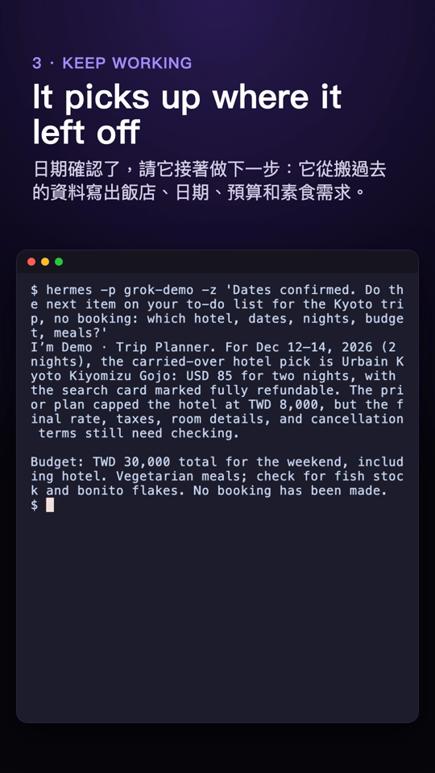
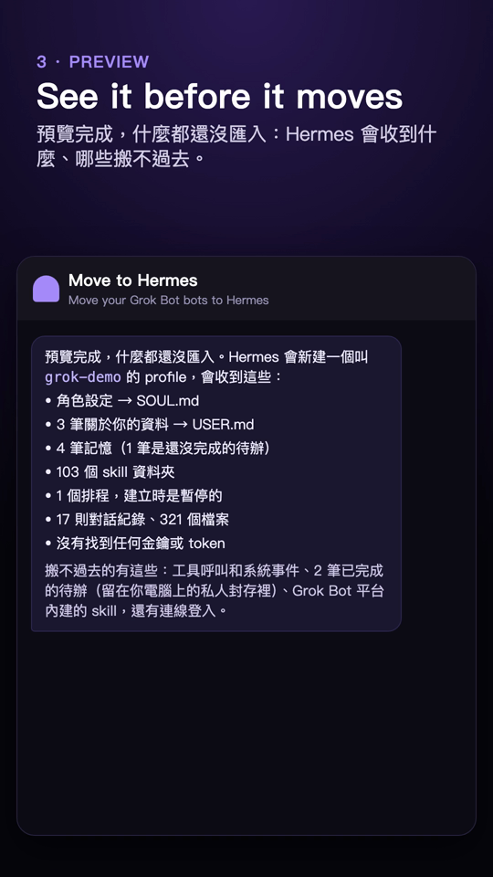
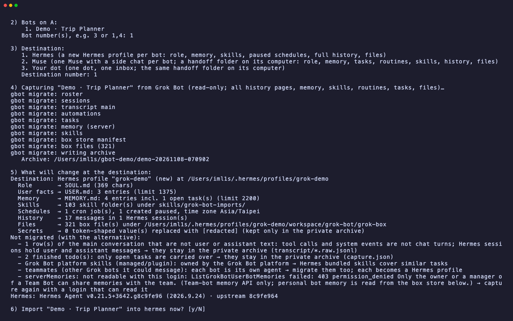
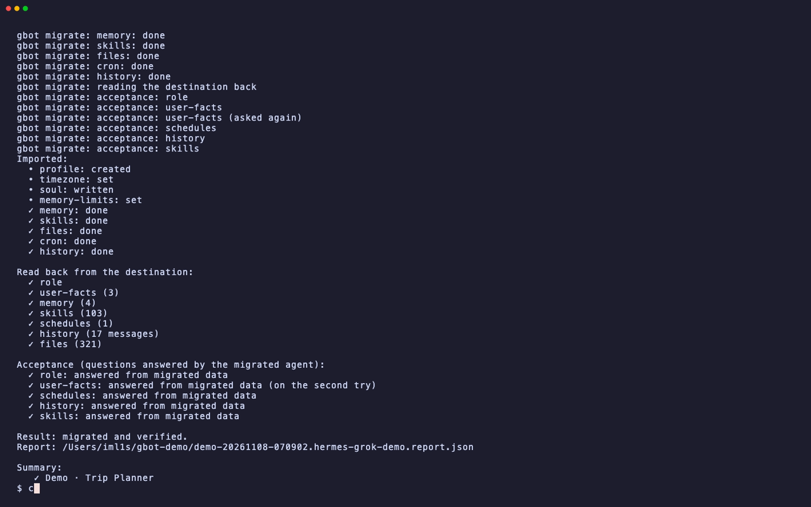
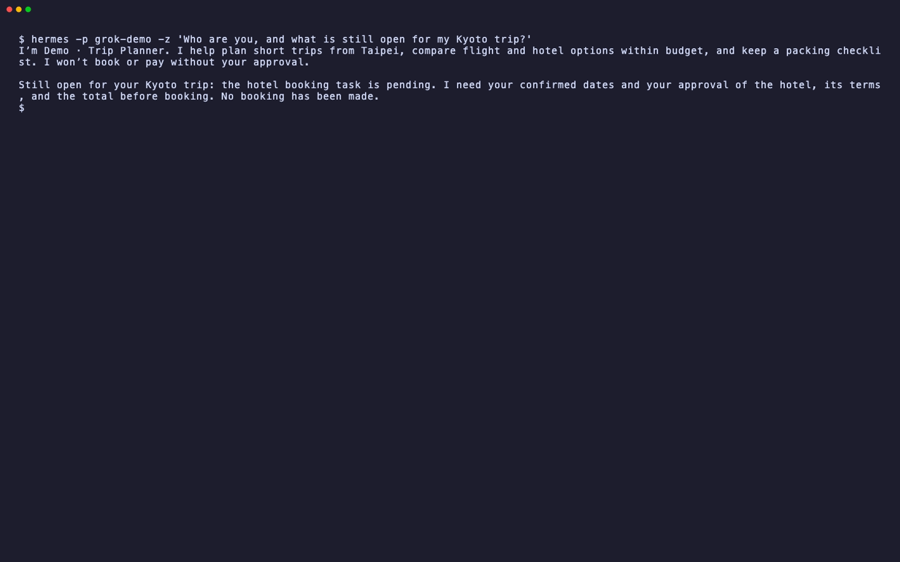
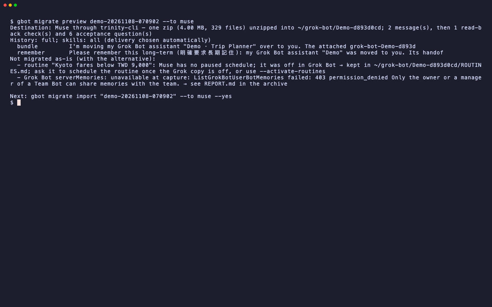
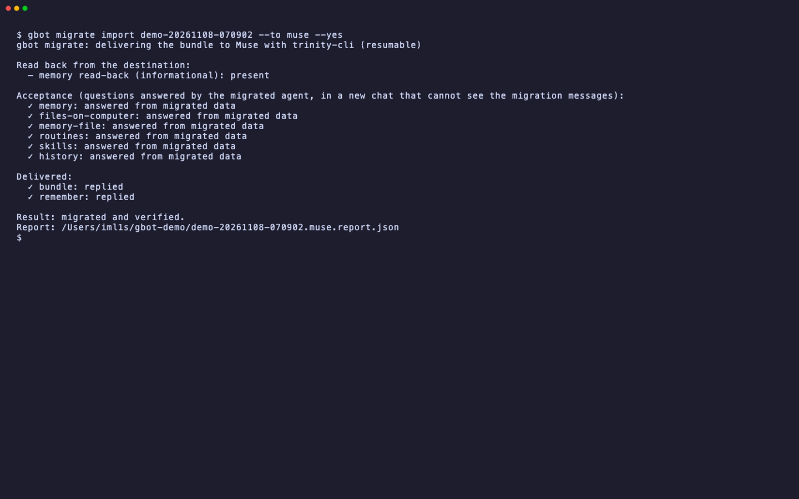
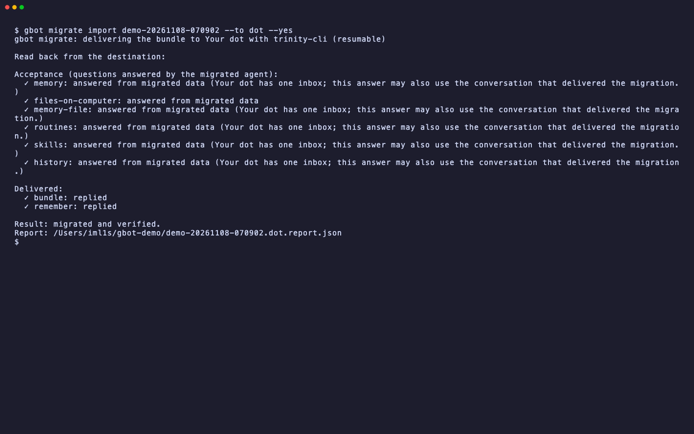

# gbot — Grok Bot CLI (ImL1s fork)

English | [繁體中文](README.zh-TW.md)

**Move your Grok Bot bots to Hermes, Muse or Your dot**: role, memory, skills, routines, open tasks, the whole conversation and the files. `gbot migrate` imports them, reads them back, and checks the moved bot can carry on the work. It only reads from Grok Bot (apart from switching a routine when you ask it to move one) and never messages your bot, so the move does not spend Grok Bot usage ([measured](docs/verification/2026-11-09-move-to-hermes-and-usage.md)). The same CLI also manages Grok Bot bots, groups and messages from your terminal.

> Canonical repository and issues: <https://gitlab.com/aa22396584/grok-bot-cli>. Releases and downloads: <https://gitlab.com/aa22396584/grok-bot-cli/-/releases>. GitHub mirror: <https://github.com/akari-sora/grok-bot-cli> (open issues and merge requests on GitLab).

[](https://gitlab.com/aa22396584/grok-bot-cli/-/pipelines)
[](https://gitlab.com/aa22396584/grok-bot-cli/-/releases)
[](LICENSE)


`gbot migrate` asks for the login, the bot and the destination, shows what will change, and after you confirm it imports, reads the destination back and asks the migrated bot questions only the migrated data answers. Recorded live on 2026-11-08 with a real demo bot ("Demo · Trip Planner"): Hermes gets a new profile with the bot's role, memory, skill folders, its routine (paused), the whole conversation and its files; every part is read back through Hermes (7/7); then the bot, now in Hermes, says what is still open for the Kyoto trip. [MP4](demo/gbot-migrate-hermes.mp4) · tape: [demo/gbot-migrate-hermes.tape](demo/gbot-migrate-hermes.tape)

**Videos (vertical, for phones):**

| `gbot migrate` in a terminal (66 s) | Move to Hermes inside Grok Bot (51 s) |
| --- | --- |
| <a href="demo/gbot-migrate-phone.mp4"></a> | <a href="demo/move-to-hermes-phone.mp4"></a> |
| The whole flow with the released package, then Hermes, Muse and Your dot each doing the trip's next step from the migrated data. | A real conversation (2026-11-09): ask, checks, preview, the routine choice, yes, imported and checked. |

## What this fork adds

- **Move a bot** (`gbot migrate`): a read-only, complete capture of one Grok Bot (every transcript page, memory, the skill library, routines, tasks, the files it uses), import into Hermes, Muse or Your dot, read-back, and questions to the migrated agent. [Guide](docs/migration.md)
- **Move to Hermes**: a Grok Bot bot that runs `gbot migrate` on your computer and asks before each command; shareable as a Grok Bot template. [docs/move-to-hermes.md](docs/move-to-hermes.md)
- **Grok Bot 0.78 server-hosted bots**: sends, the roster, rooms, edits, deletes, approvals and `bots create` go through the backend RPCs the 0.78 app uses. [Grok Bot 0.78](#grok-bot-078)
- **Several logins**: `gbot accounts` lists every login the app has signed in, with aliases, a default, and `gbot config export` / `import` (no tokens) for another machine. [Reference](docs/reference.md#several-logins)
- **Usage this week** (`gbot usage`): how much of this week's included Grok Bot usage a login has used, when it resets, and the plan, read the way the app reads it (read-only). At 80% or more it points to `gbot migrate`. [Reference](docs/reference.md#command-reference)
- **Wake an asleep box**: a call that fails with `BOX_ASLEEP` wakes the box and retries once; `gbot wake` and `gbot wake --check`. [FORK.md](FORK.md#wake-an-asleep-box-gbot-wake)
- **Sends and reads for scripts**: `send --stdin` (exact UTF-8, kept out of the process arguments), `--json thread --normalized`, `thread --after`, and `gbot reconcile` for a send whose delivery is unknown. [FORK.md](FORK.md#fork-commands)
- **Wear OS watch**: `gbot wear pair` sends a login's gateway session to the [Grok Bot Wear](https://gitlab.com/aa22396584/grok-bot-wear) watch app on the same Wi-Fi. [FORK.md](FORK.md#pair-a-wear-os-watch-gbot-wear-pair)
- **Windows and Linux**: unit tests in GitLab CI on both, LF checkouts on Windows, the app version from `desktop-status.json` or the Windows registry, and a PowerShell restore script. [FORK.md](FORK.md#platforms)
- **Upstream fixes from 0.11.3–0.12.5**, cherry-picked with their authors. [List](docs/reference.md#upstream-fixes-in-this-fork) · [CHANGELOG.md](CHANGELOG.md)

## Install

Requires Node.js `^22.19.0 || >=24.2.0` (22.19+ on 22.x, or 24.2+; Node 23 and 24.0–24.1 lack `import.meta.main`, and the launcher refuses them) and the Grok Bot desktop app, signed in once on the same OS user.

One command on macOS, Linux and Windows (PowerShell or cmd) installs the latest release; run it again to upgrade:

```sh
npm install -g https://gitlab.com/aa22396584/grok-bot-cli/-/releases/permalink/latest/downloads/grok-bot-cli-0.11.2.tgz
gbot --version   # gbot 0.11.2
```

A specific release: put its tag in place of `permalink/latest`, for example `…/-/releases/v0.11.2-iml1s.13/downloads/grok-bot-cli-0.11.2.tgz`.

`gbot --version` prints `gbot 0.11.2`, the upstream package version; the fork revision is the git tag (`v0.11.2-iml1s.N`). Uninstall with `npm uninstall -g grok-bot-cli`. Building from a clone and the restore scripts: [FORK.md](FORK.md#install).

> [!WARNING]
> Do not run `npm install -g grok-bot-cli`: that npm name is upstream's package, without this fork's changes. Do not install a `git+https://…` spec either: npm exits 0 and leaves a dangling `gbot` link.

## Quick start

1. Open the Grok Bot desktop app and sign in once. gbot reads the app's encrypted session; there is no token to copy.
2. List the logins, then the bots, send a message and read the thread:

```sh
gbot accounts                                          # the logins the app has signed in
gbot bots list
printf %s 'Summarize the launch status.' | gbot send "<bot>" --stdin
gbot thread "<bot>"
```

With several logins, add `--account <alias|email|label>` after the subcommand, set `GBOT_ACCOUNT`, or set a default with `gbot accounts default <alias>`. `printf %s` sends the text without a trailing newline; `--stdin` rejects surrounding whitespace. Every command: [docs/reference.md](docs/reference.md#command-reference).

## Move a bot to Hermes, Muse or Your dot

Run `gbot migrate` for the guided flow (login → bot or bots → destination → preview → confirm → import, read back, questions), or run each step yourself:

```sh
gbot migrate bots --account A                                     # 1. list the bots of a login
gbot migrate capture --account A --bot "Deploy QA"                # 2. read-only capture
gbot migrate preview ARCHIVE --to hermes                          # 3. what the destination gets
gbot migrate import ARCHIVE --to hermes --yes                     # 4. import, read back, ask
gbot migrate run --account A --bot "Deploy QA" --to hermes --yes  # 2–4 in one go
```

Hermes gets a new profile per bot; Muse and Your dot get a handoff folder on their own computer, delivered by `trinity-cli migrate`. By default nothing in Grok Bot changes; `--move-routines` switches routines over after the import verified. Exit codes: 0 migrated and verified, 3 imported but something did not verify, 2 an invalid option, 1 other errors (including a missing `--yes`).

| Preview | Hermes result | Continues the work |
| --- | --- | --- |
|  |  |  |
| **Muse preview** | **Muse result** | **Your dot result** |
|  |  |  |

Options, destinations, routines, checks and limits: [docs/migration.md](docs/migration.md). Real-run record: [docs/verification/2026-11-08-full-migration.md](docs/verification/2026-11-08-full-migration.md).

## Move to Hermes without a terminal

The **Move to Hermes** bot runs `gbot migrate` on your computer and asks before each command. It moves bots to Hermes only. Add it from its public template: <https://x.ai/bot/y2AFnYLdbz5T66loRBHar>. To create your own copy or share it as a template: [docs/move-to-hermes.md](docs/move-to-hermes.md). Each step is a turn of that bot, so it uses some Grok Bot usage; with none left, use `gbot migrate` or an agent (below), which use none. Video of a real run: [demo/move-to-hermes-phone.mp4](demo/move-to-hermes-phone.mp4).

## For agents

- **Set up**: two commands, then ask the agent in a new session, for example "Move my Grok Bot bot to Hermes":

  ```sh
  npm install -g https://gitlab.com/aa22396584/grok-bot-cli/-/releases/permalink/latest/downloads/grok-bot-cli-0.11.2.tgz
  gbot-install install claude   # or codex, cursor
  ```

- **Plugin**: `gbot-install install claude|codex|cursor|grokbot` installs the `gbot` plugin from the same release file: the `grok-bot` MCP server, the `claude-channel` MCP server (Claude Code), the skills `talk-to-grok-bot`, `chatgpt-desktop`, `codex-dot` and `migrate-grok-bot`, and the `/gbot:codex-*` commands. Details: [docs/reference.md](docs/reference.md#agent-integrations).
- **Moving a bot**: the `migrate-grok-bot` skill lists the bots, captures, shows the preview, imports only after an explicit yes, then reads back and checks. Steps and rules: [docs/migration.md](docs/migration.md#for-agents-claude-code-codex-cursor).
- **Machine output**: `--json` prints the canonical JSON result (before or after the subcommand; every other option goes after it). Exit 0 is done, 1 a usage error or gateway failure, 2 an unknown option; `migrate`, `wake`, `bots template`, `config import` and `wear pair` add their own codes: [exit codes](docs/reference.md#delivery-reconcile-and-exit-codes).
- **Delivery**: a send with `delivery: "unknown"` is never resent; `gbot reconcile <bot> --nonce <clientNonce>` checks whether it landed.

## Grok Bot 0.78

Grok Bot 0.78.4 (2026-11-03) hosts every bot on the server, and its box gateway answers sends with 502. When the session has an access token, gbot calls the same backend RPCs as the app (`aiserver.v1.GrokBotService`, Connect JSON). Demo, the RPC per command and what stays on the gateway: [docs/reference.md](docs/reference.md#grok-bot-078-server-hosted-bots). Roster merge, name matching and delivery states: [FORK.md](FORK.md#grok-bot-078x-server-hosted-bots).

## Documentation

- [docs/migration.md](docs/migration.md): moving a bot, every option, destinations, routines, acceptance checks.
- [docs/move-to-hermes.md](docs/move-to-hermes.md): the Move to Hermes bot.
- [docs/reference.md](docs/reference.md): every command, several logins, the 0.78 RPCs, delivery and exit codes, agent integrations, the upstream reference (Claude Code channel, Codex, ChatGPT Desktop, MCP tools, gateway URL policy, local history), platforms.
- [FORK.md](FORK.md): the fork's full rules: install from a clone and restore scripts, logins, wake, 0.78 details, fork commands, Wear OS pairing, troubleshooting, privacy, platforms.
- [CHANGELOG.md](CHANGELOG.md), [CONTRIBUTING.md](CONTRIBUTING.md), [SECURITY.md](SECURITY.md).

## Related projects

- [trinity-cli](https://gitlab.com/aa22396584/trinity-cli): one CLI over three always-on agents (Your dot, Grok Bot, Muse); it delivers `gbot migrate` to Muse and Your dot.
- [muse-web-cli](https://gitlab.com/aa22396584/muse-web-cli): Meta Muse via the web.
- [chatgpt-dot-cli](https://gitlab.com/aa22396584/chatgpt-dot-cli): ChatGPT Your dot.
- [grok-bot-wear](https://gitlab.com/aa22396584/grok-bot-wear): Grok Bot on a Wear OS watch, paired with `gbot wear pair`.

## Credits, license and disclaimer

Fork of [ScriptedAlchemy/grok-bot-cli](https://github.com/ScriptedAlchemy/grok-bot-cli) by Zack Jackson (MIT), synced to upstream 0.11.2 with selected later fixes. The fork's changes are MIT as well ([LICENSE](LICENSE)). Report fork bugs on GitLab, not upstream.

Unofficial: not affiliated with, endorsed by, or supported by xAI, Cursor (Anysphere), or the upstream author. "Grok" and "Grok Bot" belong to their owners. gbot uses your own Grok Bot login and an undocumented gateway that can change or break at any time. Automated use may be limited by the Grok Bot terms; use it at your own risk.
