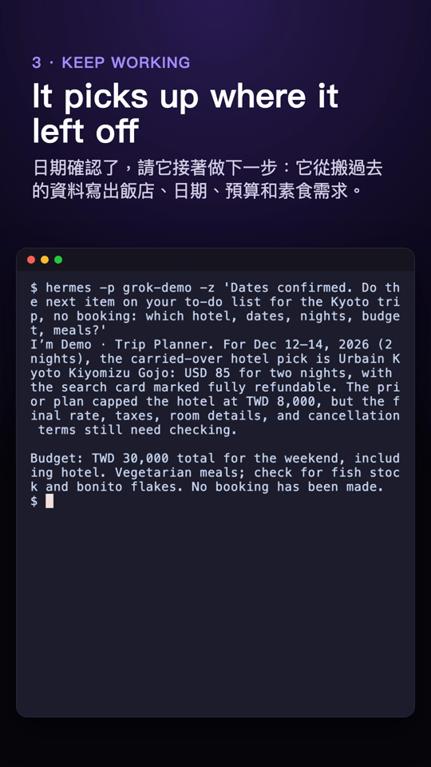
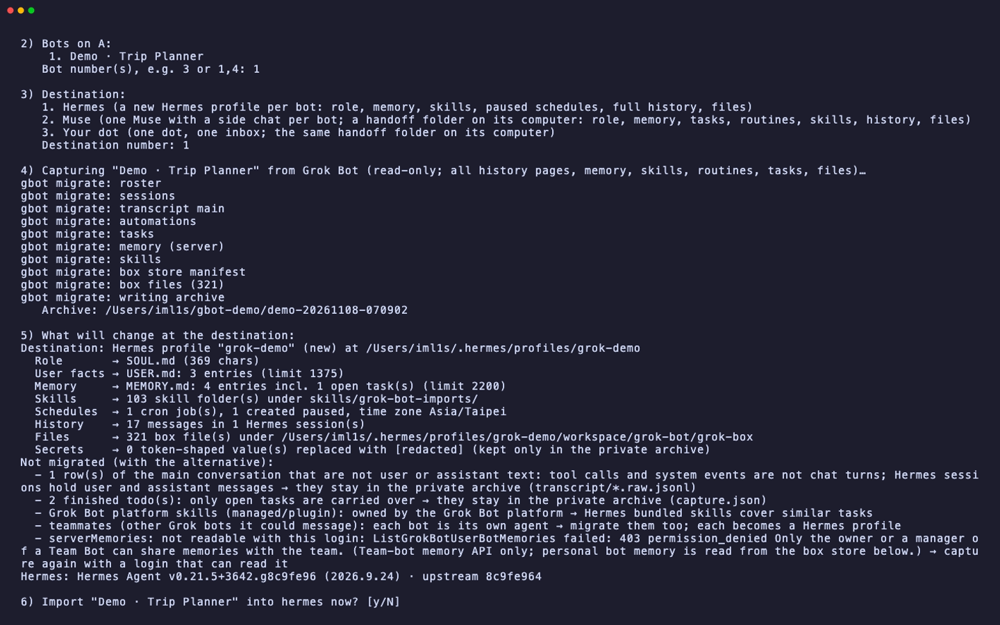
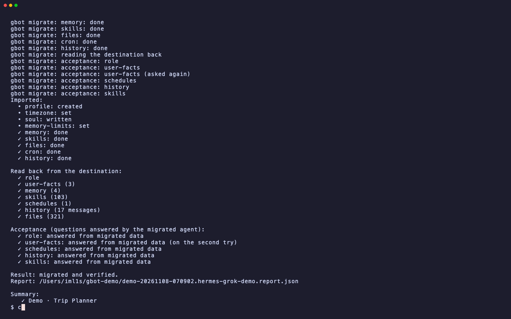
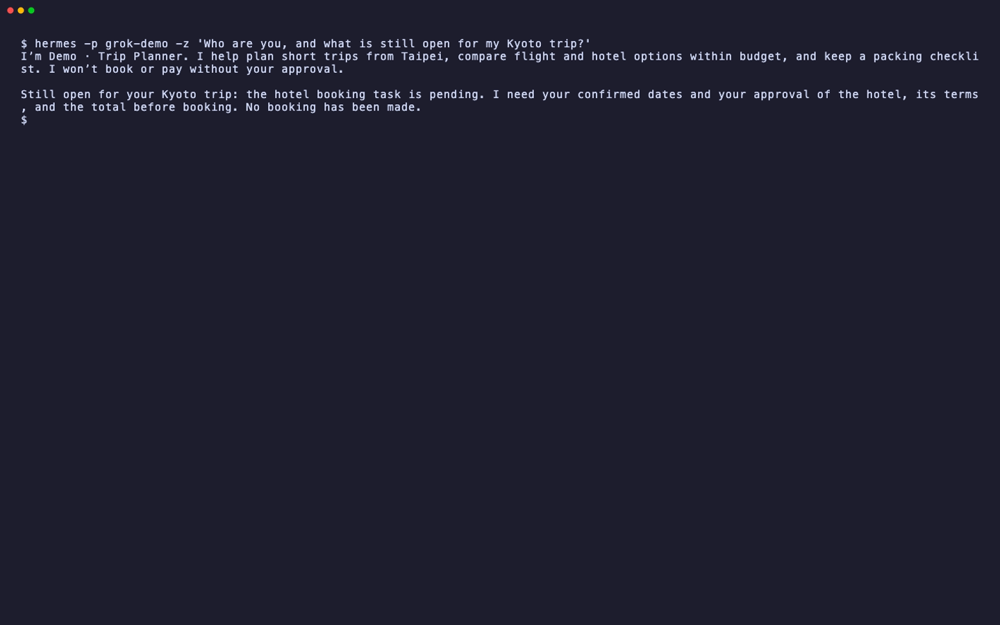
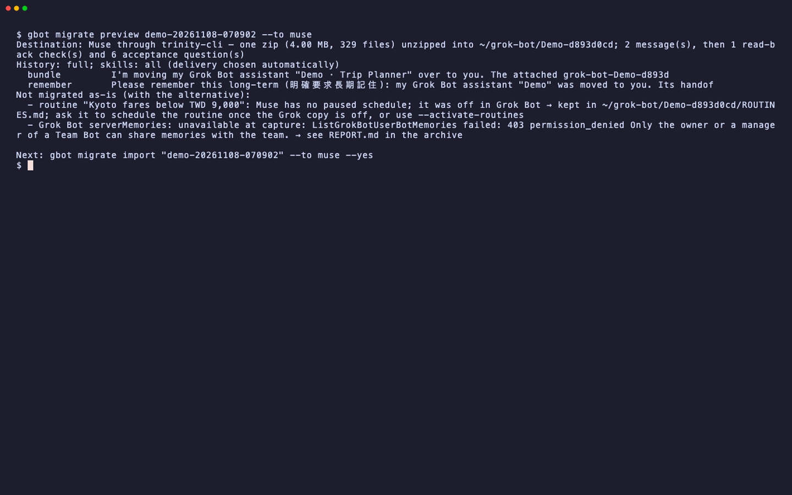
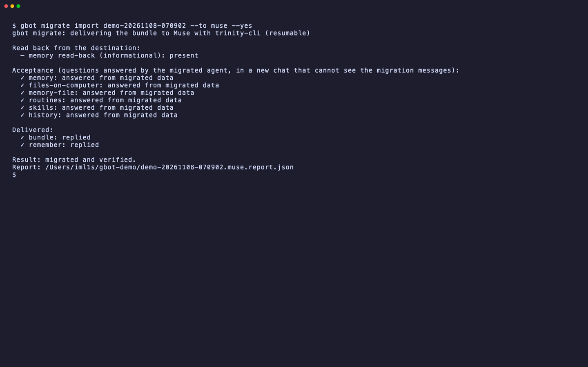
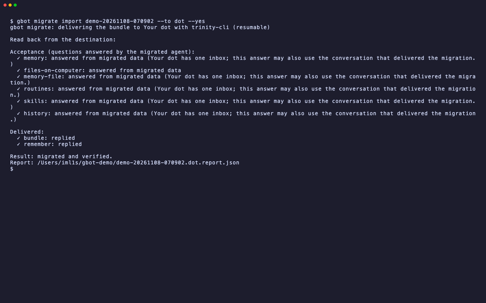

# gbot — Grok Bot CLI（ImL1s 的 fork）

[English](README.md) | 繁體中文

在終端機管理 Grok Bot 的 bot、群組和訊息，也能把 bot 搬到 Hermes、Muse 或 Your dot。

> 正本和 issue 在 <https://gitlab.com/aa22396584/grok-bot-cli>。Release 與下載：<https://gitlab.com/aa22396584/grok-bot-cli/-/releases>。GitHub 鏡像：<https://github.com/akari-sora/grok-bot-cli>（issue 與 merge request 請開在 GitLab）。

[](https://gitlab.com/aa22396584/grok-bot-cli/-/pipelines)
[](https://gitlab.com/aa22396584/grok-bot-cli/-/releases)
[](LICENSE)


`gbot migrate` 會依序問登入、bot、目的地，先列出目的地會多什麼，確認後匯入、從目的地讀回，再問搬過去的 bot 只有搬過去的資料才答得出來的問題。2026-11-08 用為示範建立的真實 bot（Demo · Trip Planner）實際錄製：Hermes 多一個新 profile，含角色、記憶、skill 資料夾、排程（先暫停）、完整對話和檔案，每一項都透過 Hermes 讀回（7/7）；最後搬到 Hermes 的 bot 說出京都行程還有哪件事沒做。[MP4](demo/gbot-migrate-hermes.mp4) · tape：[demo/gbot-migrate-hermes.tape](demo/gbot-migrate-hermes.tape)

**手機版影片（66 秒，直式）：** 用已發布的版本走完整個流程，接著 Hermes、Muse、Your dot 各自用搬過去的資料做行程的下一步，最後是 Move to Hermes 範本和給 agent 用的方式。

<a href="demo/gbot-migrate-phone.mp4"></a>

## 這個 fork 多了什麼

- **搬 bot**（`gbot migrate`）：只讀、完整地擷取一個 Grok Bot（每一頁對話、記憶、Skills 庫、排程、任務、它用到的檔案），匯入 Hermes、Muse 或 Your dot，讀回比對，再問搬過去的 agent 驗收題。[使用說明](docs/migration.zh-TW.md)
- **Move to Hermes**：一個 Grok Bot bot，在你的電腦上跑 `gbot migrate`，每條命令先徵求同意；可以用 Grok Bot 範本分享。[docs/move-to-hermes.zh-TW.md](docs/move-to-hermes.zh-TW.md)
- **Grok Bot 0.78：bot 在伺服器上執行**：送訊、名單、群組、修改、刪除、核准與 `bots create` 都改走 0.78 App 用的後端 RPC。[Grok Bot 0.78](#grok-bot-078)
- **多個登入**：`gbot accounts` 列出 App 登入過的每個帳號，可設別名、預設，並用 `gbot config export`／`import`（不含 token）搬到另一台機器。[參考](docs/reference.zh-TW.md#多個登入)
- **喚醒睡眠中的雲端電腦**：呼叫遇到 `BOX_ASLEEP` 時自動喚醒並重試一次；也有 `gbot wake` 與 `gbot wake --check`。[FORK.zh-TW.md](FORK.zh-TW.md#喚醒睡眠中的雲端電腦gbot-wake)
- **給腳本用的送訊與讀取**：`send --stdin`（UTF-8 原樣送出，不出現在行程參數裡）、`--json thread --normalized`、`thread --after`，以及送達狀態不明時用的 `gbot reconcile`。[FORK.zh-TW.md](FORK.zh-TW.md#fork-命令)
- **Wear OS 手錶**：`gbot wear pair` 把一個登入的 gateway session 送到同一個 Wi-Fi 上的 [Grok Bot Wear](https://gitlab.com/aa22396584/grok-bot-wear) 手錶 App。[FORK.zh-TW.md](FORK.zh-TW.md#配對-wear-os-手錶gbot-wear-pair)
- **Windows 與 Linux**：兩個平台都在 GitLab CI 跑單元測試、Windows checkout 維持 LF、從 `desktop-status.json` 或 Windows 登錄檔讀 App 版本，另有 PowerShell 還原腳本。[FORK.zh-TW.md](FORK.zh-TW.md#平台)
- **上游 0.11.3–0.12.5 的修正**（cherry-pick，保留原作者）。[清單](docs/reference.zh-TW.md#這個-fork-採用的上游修正) · [CHANGELOG.md](CHANGELOG.md)

## 安裝

需要 Node.js `^22.19.0 || >=24.2.0`（22.x 的 22.19 以上，或 24.2 以上；Node 23 與 24.0–24.1 沒有 `import.meta.main`，啟動器會拒絕執行），以及在同一個作業系統使用者下登入過一次的 Grok Bot 桌面版。安裝 GitLab release 附的套件檔。

macOS 或 Linux：

```sh
curl -fsSL -o grok-bot-cli-0.11.2.tgz "https://gitlab.com/-/project/86401528/uploads/983d4ae0d9209c68cc3eac5b80dd66f2/grok-bot-cli-0.11.2.tgz"
npm install -g ./grok-bot-cli-0.11.2.tgz
rm -f grok-bot-cli-0.11.2.tgz
```

Windows PowerShell：

```powershell
irm "https://gitlab.com/-/project/86401528/uploads/983d4ae0d9209c68cc3eac5b80dd66f2/grok-bot-cli-0.11.2.tgz" -OutFile grok-bot-cli-0.11.2.tgz
npm install -g .\grok-bot-cli-0.11.2.tgz
Remove-Item grok-bot-cli-0.11.2.tgz
```

```sh
gbot --version   # gbot 0.11.2
```

`gbot --version` 印出 `gbot 0.11.2`，這是上游套件版本；fork 的版本看 git 標籤（`v0.11.2-iml1s.N`）。升級就用同樣方式安裝新 release 的檔案；移除用 `npm uninstall -g grok-bot-cli`。從 clone 建置與還原腳本見 [FORK.zh-TW.md](FORK.zh-TW.md#安裝)。

> [!WARNING]
> 不要執行 `npm install -g grok-bot-cli`：npm 上這個名字是上游的套件，沒有這個 fork 的改動。也不要安裝 `git+https://…`：npm 會以結束碼 0 結束，卻留下斷掉的 `gbot` 連結。

## 快速開始

1. 打開 Grok Bot 桌面版並登入一次。gbot 讀 App 已加密的 session，不需要複製 token。
2. 列出登入、列出 bot、送訊息、讀 thread：

```sh
gbot accounts                                          # App 登入過的帳號
gbot bots list
printf %s 'Summarize the launch status.' | gbot send "<bot>" --stdin
gbot thread "<bot>"
```

有多個登入時，在子命令後面加 `--account <別名|email|標籤>`、設定 `GBOT_ACCOUNT`，或用 `gbot accounts default <別名>` 設預設。`printf %s` 送出的文字結尾不會多一個換行；`--stdin` 會拒絕兩端有空白的內容。所有命令見 [docs/reference.zh-TW.md](docs/reference.zh-TW.md#命令總覽)。

## 把 bot 搬到 Hermes、Muse 或 Your dot

在終端機打 `gbot migrate` 照提示走（登入 → 一個或多個 bot → 目的地 → 預覽 → 確認 → 匯入、讀回、驗收），或自己一步一步跑：

```sh
gbot migrate bots --account A                                     # 1. 列出這個登入的 bot
gbot migrate capture --account A --bot "Deploy QA"                # 2. 只讀擷取
gbot migrate preview ARCHIVE --to hermes                          # 3. 目的地會多什麼
gbot migrate import ARCHIVE --to hermes --yes                     # 4. 匯入、讀回、驗收
gbot migrate run --account A --bot "Deploy QA" --to hermes --yes  # 2–4 一次做完
```

Hermes 每個 bot 一個新 profile；Muse 和 Your dot 在它們自己的電腦上得到一個交接資料夾，由 `trinity-cli migrate` 送過去。預設 Grok Bot 那邊什麼都不改；`--move-routines` 在匯入驗證通過後才切換排程。結束碼：0 搬完並驗證；3 搬了但有項目沒驗過；2 選項不合法；1 其他錯誤（包括沒加 `--yes`）。

| 預覽 | Hermes 結果 | 接手工作 |
| --- | --- | --- |
|  |  |  |
| **Muse 預覽** | **Muse 結果** | **Your dot 結果** |
|  |  |  |

選項、三個目的地的差異、排程、驗收與限制見 [docs/migration.zh-TW.md](docs/migration.zh-TW.md)；實際執行紀錄（英文）見 [docs/verification/2026-11-08-full-migration.md](docs/verification/2026-11-08-full-migration.md)。

## 不開終端機：Move to Hermes

**Move to Hermes** bot 會在你的電腦上逐條徵求同意、替你跑 `gbot migrate`。它只搬到 Hermes。從公開範本加入：<https://x.ai/bot/y2AFnYLdbz5T66loRBHar>。自己建一個或用範本分享，見 [docs/move-to-hermes.zh-TW.md](docs/move-to-hermes.zh-TW.md)。

## 給 agent 用

- **外掛**：`gbot-install install claude|codex|cursor|grokbot` 安裝同一個 release 檔附帶的 `gbot` 外掛：`grok-bot` MCP server、`claude-channel` MCP server（Claude Code）、`talk-to-grok-bot`、`chatgpt-desktop`、`codex-dot`、`migrate-grok-bot` 四個 skill，以及 `/gbot:codex-*` 命令。細節見 [docs/reference.zh-TW.md](docs/reference.zh-TW.md#給-agent-用的整合)。
- **搬 bot**：`migrate-grok-bot` skill 會列出 bot、擷取、給你看預覽，明確同意後才匯入，再讀回驗收。步驟與規則見 [docs/migration.zh-TW.md](docs/migration.zh-TW.md#給-agent-用)。
- **機器可讀輸出**：`--json` 印出標準 JSON 結果（寫在子命令前後都可以；其他選項都寫在子命令後面）。結束碼 0 完成、1 參數錯誤或 gateway 失敗、2 未知選項；`migrate`、`wake`、`bots template`、`config import`、`wear pair` 另有自己的結束碼，見[結束碼](docs/reference.zh-TW.md#送達對帳與結束碼)。
- **送達**：`delivery: "unknown"` 的送出不要重送；用 `gbot reconcile <bot> --nonce <clientNonce>` 查有沒有送到。

## Grok Bot 0.78

Grok Bot 0.78.4（2026-11-03）把每個 bot 都放到伺服器上執行，雲端電腦 gateway 對送訊回 502。Session 有 access token 時，gbot 改用和 App 相同的後端 RPC（`aiserver.v1.GrokBotService`，Connect JSON）。示範、每個命令對應的 RPC、哪些仍走 gateway，見 [docs/reference.zh-TW.md](docs/reference.zh-TW.md#grok-bot-078-伺服器上的-bot)；名單合併、名稱比對與送達狀態見 [FORK.zh-TW.md](FORK.zh-TW.md#grok-bot-078xbot-改在伺服器上執行)。

## 文件

- [docs/migration.zh-TW.md](docs/migration.zh-TW.md)：搬 bot、所有選項、目的地、排程、驗收。
- [docs/move-to-hermes.zh-TW.md](docs/move-to-hermes.zh-TW.md)：Move to Hermes bot。
- [docs/reference.zh-TW.md](docs/reference.zh-TW.md)：所有命令、多個登入、0.78 的 RPC、送達與結束碼、給 agent 用的整合、平台。上游參考（Claude Code channel、Codex、ChatGPT Desktop、MCP 工具、gateway 網址規則、本機歷史）只有英文，在 [docs/reference.md](docs/reference.md#upstream-reference)。
- [FORK.zh-TW.md](FORK.zh-TW.md)：fork 的完整規則：從 clone 安裝與還原腳本、登入、喚醒、0.78 細節、fork 命令、Wear OS 配對、疑難排解、隱私、平台。
- [CHANGELOG.md](CHANGELOG.md)、[CONTRIBUTING.md](CONTRIBUTING.md)、[SECURITY.md](SECURITY.md)（英文）。

## 相關專案

- [trinity-cli](https://gitlab.com/aa22396584/trinity-cli)：一個 CLI 管三個常駐 agent（Your dot、Grok Bot、Muse），也負責把 `gbot migrate` 送到 Muse 和 Your dot。
- [muse-web-cli](https://gitlab.com/aa22396584/muse-web-cli)：網頁上的 Meta Muse。
- [chatgpt-dot-cli](https://gitlab.com/aa22396584/chatgpt-dot-cli)：ChatGPT Your dot。
- [grok-bot-wear](https://gitlab.com/aa22396584/grok-bot-wear)：Wear OS 手錶上的 Grok Bot，用 `gbot wear pair` 配對。

## 致謝、授權與聲明

這是 Zack Jackson 的 [ScriptedAlchemy/grok-bot-cli](https://github.com/ScriptedAlchemy/grok-bot-cli)（MIT）的 fork，同步到上游 0.11.2，並挑選了之後的修正。fork 的改動同樣採用 MIT（[LICENSE](LICENSE)）。fork 的問題回報到 GitLab，不要回報給上游。

非官方：與 xAI、Cursor（Anysphere）或上游作者沒有關係，也沒有得到他們的背書或支援。「Grok」與「Grok Bot」屬於各自的所有者。gbot 用你自己的 Grok Bot 登入和未公開的 gateway，隨時可能改變或失效。自動化使用可能受 Grok Bot 條款限制，風險自負。
